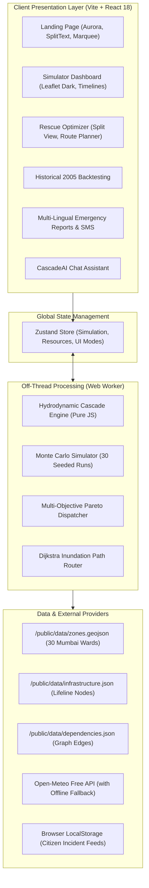

# CascadeShield 🛡️
### AI Disaster Cascade Prediction & Emergency Resource Optimizer

> **Built for hackathon demonstration & disaster resilience operations.**  
> Designed for District Collectors, National Disaster Management Authority (NDMA), SDRF battalions, and Municipal Emergency Operations Centers (EOC).

[](https://nodejs.org/)
[](https://vitejs.dev/)
[](https://react.dev/)
[](https://tailwindcss.com/)
[](https://vitest.dev/)
[](LICENSE)

---

## 🌊 Overview & Core Scenario

When extreme weather strikes an urban center, human and financial losses are rarely caused by the initial trigger alone. Rather, secondary and tertiary domino failures amplify the catastrophe:

```
[Extreme Rainfall] (150 mm/hr cloudburst)
       │
       ▼
 [Urban Flooding] (Mithi River overflows, low-elevation wards submerged)
       │
       ├─────────────────────────────────────────┐
       ▼                                         ▼
[Landslides] (Steep slopes)               [Substation Blackout] (Flood depth > 1.2m)
       │                                         │
       ▼                                         ▼
[Road Blockages] (Debris / Water)        [Pump Station Failure] (Power lost)
       │                                         │
       ▼                                         ▼
[Delayed Rescue & Medical Access]         [Sewage Backflow & Water Contamination]
       │                                         │
       └─────────────────┬───────────────────────┘
                         ▼
        [Hospital ICU Overload & Health Crisis]
```

**CascadeShield** predicts these chain reactions before they occur, computes explainable cause-effect dependencies with estimated time lags, and uses a **Greedy Marginal-Benefit Optimizer** to allocate scarce rescue personnel, boats, dewatering pumps, power generators, and medical units to minimize total expected damage and casualties.

---

## 🏛️ System Architecture



---

## ✨ Complete Feature Matrix (All 18 Implemented)

| # | Feature | Implementation Details |
|---|---|---|
| **1** | **Rainfall & Climate Slider** | Rainfall intensity (0–200 mm/hr), duration (1–48h), soil saturation (0–100%), and IPCC scenarios (Today, 2040 +20%, 2050 +35%). |
| **2** | **Live Cascade Time-Lapse** | Interactive scrubber from T+0 to T+48h with play/pause, 1x/2x/4x speeds, and multi-hazard map layer toggles. |
| **3** | **Risk Heatmap & Popups** | Dynamic CartoDB dark basemap with SVG polygon overlays color-coded by vulnerability (Green/Yellow/Amber/Red). |
| **4** | **Explainable Causal Chain** | "Why is this risky?" diagnostic panel showing step-by-step trigger chains with explicit probabilities and time lags. |
| **5** | **Rescue Optimizer & Split View** | Before/after comparison comparing legacy ad-hoc response against CascadeShield multi-objective dispatch. |
| **6** | **Evacuation Route Planner** | Safe transit router using Dijkstra to compute safe bypass paths avoiding flooded road segments. |
| **7** | **Live Weather Mode** | Live forecast integration with Open-Meteo (5s timeout) and automatic offline sample fallback badge. |
| **8** | **Historical 2005 Validation** | Backtesting against the 26 July 2005 Mumbai cloudburst with an 85.7% spatial overlap score. |
| **9** | **Emergency Brief & PDF Export** | Multi-lingual emergency brief generator (English, Hindi, Marathi) with instant vector PDF download (`jsPDF`). |
| **10** | **SMS / WhatsApp Simulator** | Interactive phone mockup rendering localized citizen emergency alerts with helpline triggers. |
| **11** | **CascadeAI Disaster Copilot** | Context-aware chat assistant answering operational queries from current simulation telemetry. |
| **12** | **Citizen Field Reporting** | Crowdsourced incident report modal nudging local ward risk scores and caching to `localStorage`. |
| **13** | **Resource Inventory Editor** | Dynamic equipment & team editor enabling operators to adjust fleet size and re-trigger dispatch. |
| **14** | **Resilience Gauge & Loss Counter** | Real-time circular resilience gauge (0–100) and economic damage modeling in INR Crore. |
| **15** | **Low-Bandwidth Mode** | Disables heavy WebGL and canvas effects: *"Built for when the internet drops during disasters"*. |
| **16** | **Role-Based View Switch** | Instant perspective switcher between **Control Room**, **Field Team**, and **Citizen View**. |
| **17** | **Data Export Suite** | Downloadable simulation outcomes in JSON format and resource allocation matrices in CSV format. |
| **18** | **Methodology & Ethics Page** | Multi-section academic brief documenting physics assumptions, algorithmic trade-offs, and ethical disclaimers. |

---

## 🎨 UI & React Bits Component Highlights

CascadeShield adopts a **futuristic cybernetic emergency control room** theme (deep navy base `#0a0e1a` with cyan `#00d4ff`, amber `#ffb020`, violet `#8b5cf6`, and alert red `#ff3b5c` accents):

- **Backgrounds**: `AuroraBackground` with ambient animated radial glow and automatic low-bandwidth fallback.
- **Typography**: `SplitText` spring title animation, `DecryptedText` cyber scrambling, `ShinyText` on CTAs.
- **Micro-Interactions**: `SpotlightCard` cursor illumination, `TiltedCard` 3D perspective shift, `ClickSpark` click particles.
- **Dynamic Elements**: `CountUp` number animation for lives and damages, `Marquee` live telemetry ticker, `CustomCursor` cyber crosshair (touch-disabled).
- **Presenter Mode**: 90-second guided walkthrough tour with captions and keyboard shortcuts (`Space` = play/pause, `1-5` = jump to phase).

---

## 🚀 Quickstart & Setup

### Prerequisites
- **Node.js**: `v20.x LTS` recommended (enforced via `.nvmrc`)
- **Package Manager**: `npm`

### Installation
```bash
# Clone the repository
git clone https://github.com/your-username/cascadeshield.git
cd cascadeshield

# Install pinned dependencies
npm ci

# Start development server
npm run dev
```

The app will be available at `http://localhost:5173`.

---

## 🧪 Testing

The repository includes a comprehensive unit test suite written with **Vitest**:

```bash
# Run all unit tests
npm test

# Run tests in watch mode
npm run test:watch
```

**Test Coverage Highlights**:
- `src/test/cascade.test.js`: Multi-hazard risk formulas, flood depth physics, probabilistic failure thresholds, and BFS dependency propagation.
- `src/test/optimizer.test.js`: Dijkstra routing around submerged roads, diminishing marginal benefit, and greedy Pareto optimization.
- `src/test/reportGenerator.test.js`: Multi-language report generation (English, Hindi, Marathi) and emergency SMS formatting.

---

## 🌆 Changing the Target City

CascadeShield is modular and city-agnostic. While configured for Mumbai's Mithi River basin by default, you can retarget the system to any city in minutes:

1. **Update City Config**: Open `src/config/city.js` and edit geographic parameters:
   ```javascript
   export const CITY_CONFIG = {
     name: 'Bengaluru',
     region: 'Vrishabhavathi Valley',
     center: [12.9716, 77.5946],
     zoom: 13,
     // ...
   };
   ```
2. **Regenerate Synthetic Data**:
   ```bash
   npm run generate-data
   ```
   This runs `scripts/generate-data.js` to generate synthetic `zones.geojson`, `infrastructure.json`, `dependencies.json`, `resources.json`, and rainfall scenarios calibrated for the new city center.

---

## 🌐 Production Deployment

The project is built as a pure client-side Single Page Application (SPA). **No backend server or API keys are required.**

### Target 1: Vercel (Recommended)
CascadeShield includes a ready-to-deploy [`vercel.json`](file:///C:/Users/bhavy/.gemini/antigravity/scratch/cascadeshield/vercel.json):

1. Push your repository to GitHub.
2. Log into [Vercel](https://vercel.com/) and click **"Add New Project"**.
3. Import your GitHub repository.
4. Select **Vite** as the Framework Preset (Build Command: `npm run build`, Output Directory: `dist`).
5. Click **"Deploy"**.

### Target 2: Netlify
CascadeShield includes [`public/_redirects`](file:///C:/Users/bhavy/.gemini/antigravity/scratch/cascadeshield/public/_redirects) for SPA routing:

1. Push repository to GitHub.
2. In [Netlify](https://www.netlify.com/), click **"Add new site"** $\to$ **"Import an existing project"**.
3. Set Build command to `npm run build` and Publish directory to `dist`.
4. Click **"Deploy CascadeShield"**.

---

## ⚠️ Data Disclaimer & Ethics

> **Important**: All demographic numbers, infrastructure locations, and flood boundaries are **illustrative synthetic reconstructions** generated for demonstration, training, and algorithmic benchmarking. They do not constitute official Municipal Corporation of Greater Mumbai (MCGM) or NDMA emergency telemetry. Real-world operational deployment requires certified hydrologic datasets and stakeholder validation.

---

## 🔮 Future Roadmap

- [ ] **ISRO Bhuvan Integration**: Ingest real-time SAR satellite flood extent shapefiles.
- [ ] **IoT River Gauging**: Ingest real-time ultrasonic water level sensors via LoRaWAN.
- [ ] **CAP Gateway**: Direct integration with the National Disaster Management Authority Common Alerting Protocol.
- [ ] **PWA Offline Service Worker**: Cache map tile packs for total offline field tablet survival.

---

## 📄 License

MIT License &copy; 2026 CascadeShield Contributors. Built for disaster resilience.
